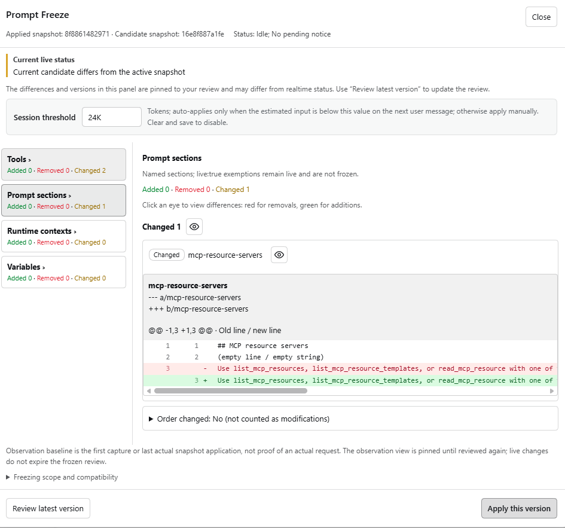

# Prompt Freeze

Freezes a session's tool declarations and named system-prompt sections; changes apply only when you review them. npm package `@lemonel/dsh-prompt-freeze`. No cache-hit guarantee, and it never blocks or restricts tools.

[中文](./README.md)

## Features

- Snapshot on the first real request, replayed verbatim afterwards.
- Panel diffs per tools / sections / contexts / variables; nothing changes until *Apply this version* (idle agent required).
- Contexts, variables and `live` sections are not frozen and show as "Live · cache invalidated"; *Acknowledge live differences* only stops showing them.
- Auto-apply: per-session threshold (default 24K tokens), checked only on the next genuine user message.
- Unknown write outcome stops the session: keep or recapture. Delegated sessions keep automatically and report to the parent panel.
- UI follows the DSH locale service; tool names, schemas and source text are not translated.

## Install

DSH `0.2.0-rc.1`–`0.2.1`.

```sh
npm ci && npm pack
```

Install the tgz from the Plugins page and select the bundle. By hand:

```yaml
- id: prompt-freeze
  name: '@lemonel/dsh-prompt-freeze'
  config:
    directory: /absolute/private/path/prompt-freeze
```

`directory` defaults to `<profile dir>/cache-guard/<profile identity hash>`; `autoApplyBelow` takes K/M (K=1000), empty disables. Reload the backend and refresh after install.

## Usage



Open the panel from the Prompt Freeze trigger left of the composer:

1. Eye button opens the diff.
2. On a diff: *Review latest version* → *Apply this version*.
3. Live-only changes: *Acknowledge live differences*.

Without auto-apply, doing nothing keeps the active version.

## Data and limits

- State in `<profile dir>/cache-guard/<identity hash>/`: per-session manifest + `payload-<sha256>.json`; files 0600, directories 0700.
- One process per directory; no cross-process lock.
- Payloads are never collected; the directory only grows.
- No cache-hit or billing guarantee; model changes, compaction and provider expiry still invalidate.
- An outer assembly hook can append tools after replay, so the final request may differ from the snapshot.
- Compatibility: `source.kind=prompt-freeze`, `cache-guard` and `tool-declaration-snapshot` still accepted; storage keeps the name `cache-guard`.

## Compatibility

| DSH | Result |
| --- | --- |
| `0.2.0-rc.1` / `0.2.0-rc.2` | pass |
| `0.2.1-alpha.4` | pass (upstream dropped `both`) |

`@deepseek-ai/*` are `peerDependencies` with explicit prerelease ranges; an out-of-range host disables the plugin at startup.

## Development

```sh
npm install && npm run typecheck && npm test
```

Ordinary TypeScript sources (strict): entries are `src/backend_index.ts` and `src/frontend_index.ts`, with implementations in `src/backend/` and `src/frontend/`, and `src/shared/` contains the shared RPC contract; `npm run build` emits `lib/`. Do not commit or edit `lib/`; build before installing a local link.
