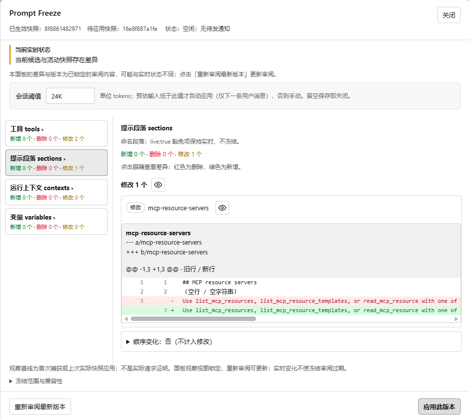

# Prompt Freeze / 提示前缀冻结

冻结会话的工具声明和命名提示段落（system prompt），防止意外改动导致的缓存失效，审阅后决定是否修改。npm 包 `@lemonel/dsh-prompt-freeze`，不保证缓存命中，也不阻止或限制工具执行。

[English](./README.en.md)

## 功能

- 首次真实请求建快照，之后原样回放。
- 面板按 tools / sections / contexts / variables 列差异，点「应用此版本」才生效（需空闲）。
- contexts、variables、`live` 段落不冻结，标「实时 · 缓存已失效」；「确认实时差异」只停止显示。
- 自动应用：阈值按会话设（默认 24K tokens），仅下一条真实用户消息触发。
- 写入结果不确定时停下，选保留或重建；子会话自动保留并冒泡到父面板。
- 界面跟随 DSH locale；工具名、schema、原文不翻译。

## 安装

DSH `0.2.0-rc.1`–`0.2.1`。

一条命令安装预构建包，无需本地编译：

```sh
dsh plugin --profile web add https://github.com/lemonel/dsh-prompt-freeze/releases/download/v1.0.0/lemonel-dsh-prompt-freeze-1.0.0.tgz
```

将 `web` 替换为实际使用的 profile；安装后确认 bundle 已启用，重载后端并刷新页面。

也可以从 [GitHub Release](https://github.com/lemonel/dsh-prompt-freeze/releases/tag/v1.0.0) 下载 tgz，在 Plugins 页安装并勾选 bundle。

从源码打包（在仓库根目录执行）：

```sh
npm ci && npm pack
```

手动接入：

```yaml
- id: prompt-freeze
  name: '@lemonel/dsh-prompt-freeze'
  config:
    directory: /absolute/private/path/prompt-freeze
```

`directory` 默认 `<profile 目录>/cache-guard/<profile 身份哈希>`；`autoApplyBelow` 支持 K/M（K=1000），留空关闭。装完重载后端、刷新页面。

## 使用

入口在输入栏左侧，点击「Prompt Freeze」：




1. 眼睛按钮看差异。
2. 有差异：重新审阅最新版本 → 应用此版本。
3. 仅实时内容变化：确认实时差异。

不开自动应用时，不点即沿用活动版本。

## 数据与边界

- 状态在 `<profile 目录>/cache-guard/<身份哈希>/`：会话 manifest + `payload-<sha256>.json`；文件 0600，目录 0700。
- 单进程独占，无跨进程锁。
- payload 不回收，目录只增。
- 不承诺缓存命中或计费；模型变化、compact、上游过期仍会失效。
- 外层 assembly 可在快照外追加工具，最终请求可能与快照不一致。
- 历史兼容：`source.kind=prompt-freeze`，仍接受 `cache-guard`、`tool-declaration-snapshot`；存储目录沿用 `cache-guard`。

## 兼容性

| DSH | 结果 |
| --- | --- |
| `0.2.0-rc.1` / `0.2.0-rc.2` | 通过 |
| `0.2.1-alpha.4` | 通过（上游移除 `both` 模式） |

`@deepseek-ai/*` 为 `peerDependencies` 且带预发布区间；越界版本启动时禁用插件。

## 开发

```sh
npm install && npm run typecheck && npm test
```

源码使用普通 TS（strict）：入口为 `src/backend_index.ts` 和 `src/frontend_index.ts`，实现分别放在 `src/backend/` 与 `src/frontend/`，`src/shared/` 为两端共用的 RPC 契约；`npm run build` 生成 `lib/`。`lib/` 不提交、不手改，本地链接安装前先构建。
